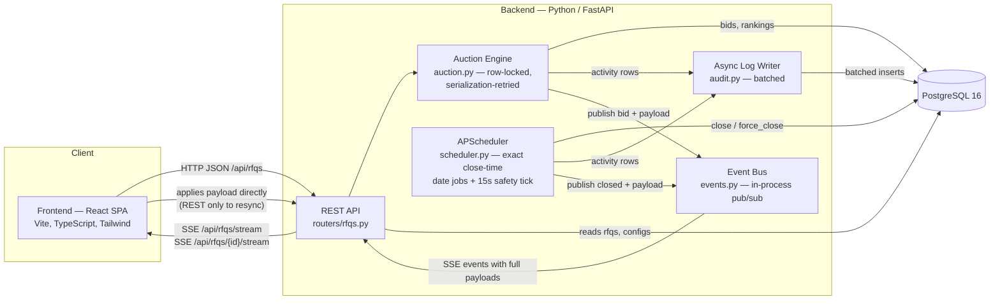
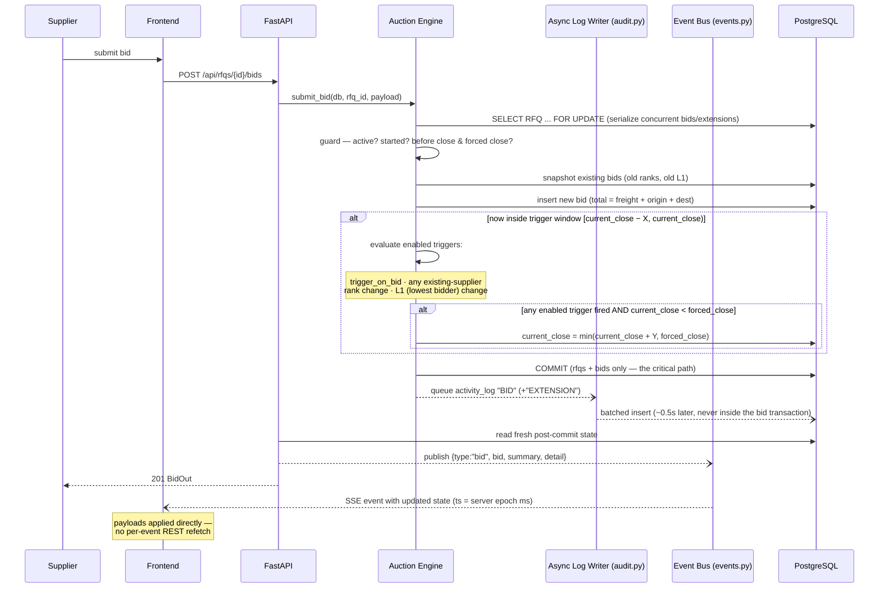

# HLD — British Auction in RFQ System

## 1. Overview

A simplified RFQ (Request for Quotation) system with British Auction–style bid
competition. Suppliers submit open bids and compete by undercutting each other.
To prevent last-second sniping, bids placed inside a configurable end-window
automatically extend the auction close - never beyond a hard *forced close*.

## 2. Architecture Diagram



## 3. Components

| Component | Responsibility |
|---|---|
| **Frontend (React SPA)** | RFQ creation with auction config; listing page (lowest bid, current/forced close, status); detail page (bids ranked L1..Ln, quote details, config, activity log, server-synced countdown). Updates arrive via Server-Sent Events **carrying the updated state itself** (applied directly, no refetch per event), with slow (15s) polling as reconnect fallback. |
| **REST API (FastAPI)** | `POST /api/rfqs` (create RFQ + config), `GET /api/rfqs`, `GET /api/rfqs/{id}` (detail incl. ranks, logs), `POST /api/rfqs/{id}/bids`, `GET /api/rfqs/stream` + `GET /api/rfqs/{id}/stream` (SSE), `GET /api/health`. |
| **Auction Engine** | Accepts a bid only while the auction is open, recomputes rankings, and decides whether the close time must be extended based on the RFQ's trigger configuration. Takes a `SELECT ... FOR UPDATE` lock on the RFQ row and retries on serialization failures; commits `rfqs`+`bids` only, and publishes a `{type: bid}` event with the full updated payload. |
| **Event Bus (`events.py`)** | Tiny in-process pub/sub keyed by topic (`rfq:<id>`, `rfqs`). Broadcasts update events (bid/ranking/deadline, status flips) from the engine and scheduler to SSE subscribers, every event stamped with the server's epoch ms (`ts`) for client clock-sync. Thread-safe across the FastAPI threadpool and worker threads. |
| **Async Log Writer (`audit.py`)** | Activity-log rows are queued by the engine/scheduler after their critical transaction commits, then written in small batches by a dedicated daemon thread — log inserts never prolong the row lock or delay a supplier's 201 response. |
| **Scheduler** | Schedules an exact one-shot APScheduler `date` job per active RFQ at precisely its `current_close` and `forced_close`, moving the job whenever an extension moves the deadline; takes the same row lock as the engine so closing never races an in-flight bid. A 15s interval tick remains only as a reconciliation safety net. |
| **PostgreSQL** | Single source of truth. Datetimes are stored as naive UTC everywhere. |

## 4. Bid Submission & Extension Flow



## 5. Real-Time Model (SSE)

Bidding must feel live - a supplier who is being undercut needs to know in well
under a second to react while the trigger window is still open. The system
therefore pushes auction updates instead of relying on client-side polling:

- **Transport:** SSE (`GET /api/rfqs/{id}/stream` for the detail page,
  `GET /api/rfqs/stream` for the listing). Chosen over WebSockets because the
  traffic is one-directional (all writes go through REST), reconnection is
  built into `EventSource`, and no extra protocol/proxy negotiation is needed.
- **Events carry state, not just hints:** each event includes the updated
  data itself — the accepted bid + full ranking + possibly extended
  `current_close` (and, for the detail topic, the whole detail projection)
  for bids; the updated summary row for status flips and creations. Clients
  apply the payload directly, which eliminates the thundering herd where N
  viewers of one RFQ would fire N identical `GET /api/rfqs/{id}` calls on
  every bid. REST remains the authority and the resync path (reconnect,
  missed events, unparseable messages); events are still best-effort push
  after the change is committed — a dropped event costs a slower
  resynchronization (next event or 15s poll), never consistency.
- **Server clock sync:** every event is stamped with `ts` (server epoch ms).
  The close/extension decision uses the server clock exclusively; the
  client's countdown syncs its offset from `ts` so a skewed browser clock
  cannot show "2s left" on an auction the server already closed.
- **Push points:** accepted bid (`submit_bid` → `place_bid`),
  close / force-close transitions (exact per-RFQ scheduler jobs), RFQ
  creation. One bid that also triggers an extension surfaces both in a
  single event.
- **Fallback:** slow polling (15s) covers a disconnected/slow-reconnecting
  stream; the UI shows `● live` vs `◌ reconnecting`. `: keepalive` comments
  every 20s keep proxies from idling the connection out.
- **Trade-off / scale boundary:** the bus is in-process, so events fan out
  correctly as long as the API runs one instance — the current docker-compose
  setup. Running multiple uvicorn workers would require putting a shared
  fan-out (Redis pub/sub) behind `events.publish`; the publish/subscribe
  seam already isolates that change.

## 6. Auction Lifecycle

```
created (active) ──▶ bid_start ──▶ current_close* ──▶ forced_close
                                  │  * may move forward by +Y on each
                                  │    qualifying trigger, capped at forced_close
```

- `original_close` is immutable (audit trail); only `current_close` ever moves.
- **Closing is exact, not interval-based:** each active RFQ gets a one-shot
  APScheduler `date` job at precisely its `current_close` and `forced_close`,
  reinstalled by `scheduler.reschedule` whenever a bid extends the deadline
  (soft-close moves the job with the deadline). The transition transaction
  takes the same row lock as the bid path, so a close job racing an in-flight
  bid re-reads the extended deadline and does nothing. A coarse 15s tick is
  retained only as a reconciliation safety net for restarts.

  Status transitions (`scheduler._transition`):
  - `active → closed` when `now ≥ current_close`
  - `active → force_closed` when `now ≥ forced_close`

## 7. Timezone Convention

All timestamps are stored **naive UTC**. The frontend converts
`<input type="datetime-local">` local values to UTC ISO on submit
(`localInputToUtcIso`) and renders stored values back in the viewer's local
timezone with a pinned `dd-mm-yyyy` format (`fmtUtc` in `src/time.ts`).

## 8. Extension Trigger Rules (spec §6 → implementation)

| Trigger (per RFQ config) | Fires when |
|---|---|
| a) trigger_on_bid | any bid is received inside the window |
| b) trigger_on_any_rank_change | an *existing* supplier's rank changes in the window (a brand-new bid at the bottom does not shift anyone) |
| c) trigger_on_l1_change | the lowest bidder (L1) is a different bid after the insert |

Multiple triggers may fire from one bid → one extension, single log entry with
all reasons joined. Extension is always `min(current_close + Y, forced_close)`.

## 9. Concurrency & Clock Rules

| Concern / Requirement | Mechanism |
|---|---|
| Race on `current_close` in the final seconds | `submit_bid` runs inside a transaction holding `SELECT ... FOR UPDATE` on the RFQ row — extensions are evaluated and applied by exactly one transaction at a time; the next concurrent bid sees the extended deadline. |
| Serialization failures / deadlocks under load | `submit_bid` retries the whole transaction (up to 4 attempts, brief backoff) on pgcodes `40001`/`40P01`; the route maps an exhausted budget to `503` with `Retry-After`. |
| Client clock skew | All close/extension validation uses the server clock. SSE events carry `ts` (server epoch ms); the frontend syncs an offset (`serverClock.ts`) and computes countdowns against `serverNow()`. |
| Write amplification on `activity_logs` | Activity rows are written asynchronously by `audit.py` (single daemon thread, batched inserts in its own connection) so they never prolong the RFQ row lock or delay the 201. `activity_logs` carries a composite `(rfq_id, created_at)` index for the detail-page read pattern. |
| Thundering herd on per-event refetch | SSE events carry the updated state; clients apply payloads directly and only poll/refetch on disconnect or hint-only events. |
