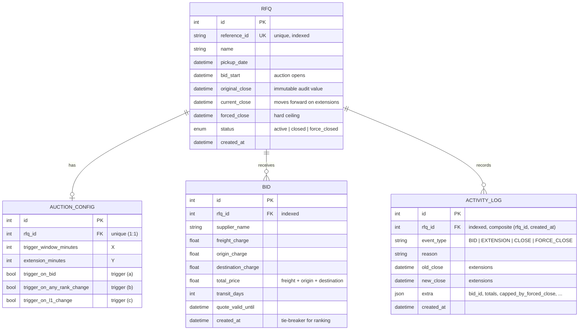

# Schema Design — British Auction in RFQ System

4 tables: `rfqs`, `auction_configs` (1:1), `bids` (1:N), `activity_logs` (1:N).

## Design Decisions

1. **Three close timestamps, not one.**
   - `original_close` - never mutated; preserved for the audit trail and the
     original→current extension delta.
   - `current_close` - the only field the auction engine mutates; only moves
     forward, never past `forced_close`.
   - `forced_close` - hard ceiling; also drives force-close status.

2. **`total_price` is stored, not derived.** The ranking field
   (`ORDER BY total_price, created_at ASC`) is materialised at insert time
   (freight + origin + destination) so ranking is a cheap sort on an indexed
   scalar and future filtering (e.g. reports) needs no recomputation.
   Ties break by *earliest submission wins*.

3. **`activity_logs.extra` as JSON.** Keeps the schema stable while events
   carry event-specific payloads (rank after bid, whether the extension hit
   the forced-close cap, X/Y used). `event_type` is a plain string with an
   application-level enum of the four documented values.

4. **`auction_configs` split from `rfqs`** (not one wide table) — the
   auction knobs are a cohesive value object, validated as one Pydantic model,
   and keep the RFQ columns about the *request* rather than the auction rules.
   `rfq_id` is UNIQUE enforcing the 1:1 relationship.

5. **Naive UTC datetimes.** One timezone convention end-to-end; the frontend
   owns all localisation. Avoids `timestamptz` rendering differences across
   drivers/hosts.

6. **The real-time layer is schemaless by design.** SSE/notification state
   (the in-process event bus) lives purely in memory; events reconstruct
   their payload from the authoritative tables after each commit, so there is
   nothing to persist, number, or replay — a lost event is healed by the next
   event or the fallback poll's REST resync. No schema provision is needed
   for the real-time layer.

## Integrity Rules Enforced (application layer)

| Rule | Enforced in |
|---|---|
| `forced_close > bid_close > bid_start` | `schemas.RFQCreate` validator |
| non-negative charges, `transit_days ≥ 0` | `BidCreate` field constraints |
| bid only while `bid_start ≤ now < current_close` and `now < forced_close` | `auction.submit_bid` |
| `current_close + Y ≤ forced_close` (cap) | `auction.submit_bid` |
| unique `reference_id` | router check + DB unique column |
| closes flip status at the exact close time (15s safety net) | `scheduler._transition` |

## Scaling / concurrency notes

- **Row-level locking:** bid submission and close transitions both take
  `SELECT ... FOR UPDATE` on the `rfqs` row, so concurrent final-second bids
  serialize extension evaluation, and closing cannot race an in-flight bid.
- **Retry on serialization failures:** `submit_bid` retries the transaction on
  pgcodes `40001`/`40P01` before the route surfaces `503 Retry-After`.
- **Activity-log throughput:** `activity_logs` inserts are batched
  asynchronously (audit.py) and the table carries a composite
  `(rfq_id, created_at)` index, keeping log-write pressure off the bid path.
